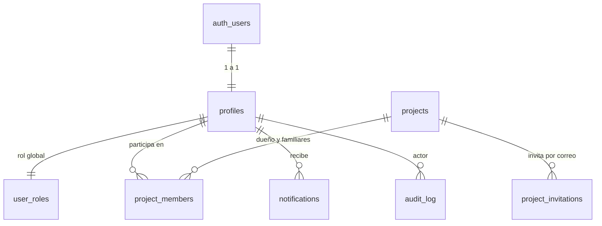
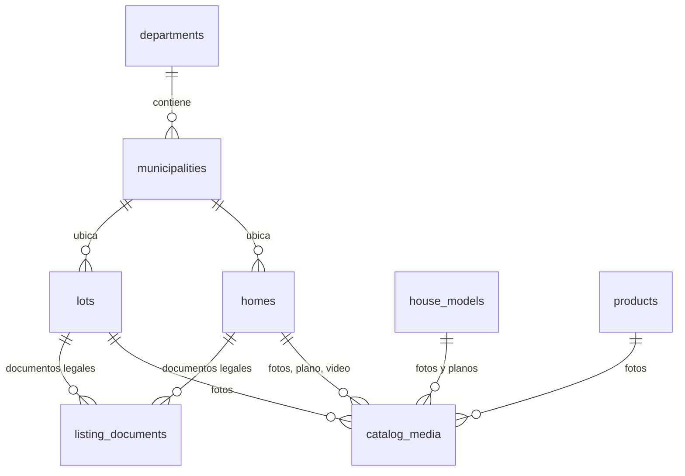
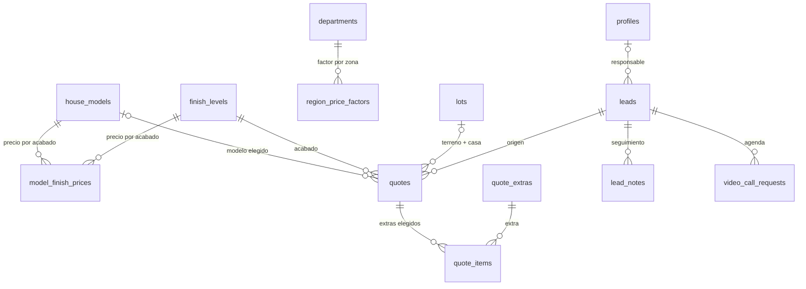
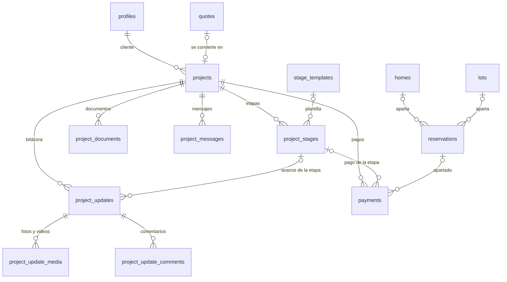
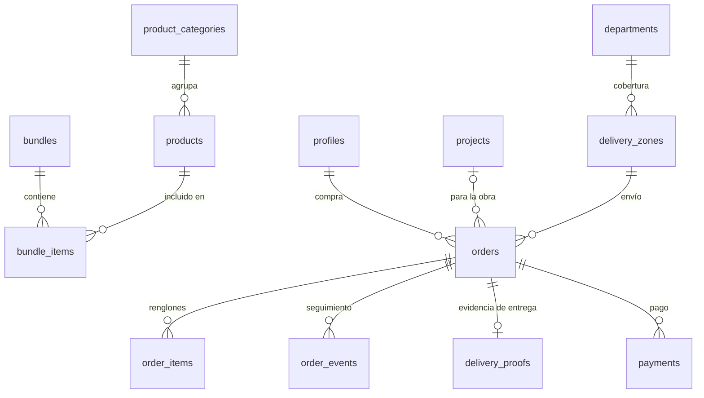

# Plan de la Fase 0 — ConstruFácil

**Estado:** aprobado y montado (Fase 0 terminada) · **Fecha:** 24 nov 2026

Este documento define la arquitectura, el modelo de datos y las rutas. El estilo elegido es la opción B con la paleta B1 "Teja" (ver `docs/decisiones.md` y `src/app/globals.css`). La base de la sección 11 ya está montada; las tablas de las fases 1 a 3 se crean en su fase.

## 1. Decisiones ya tomadas

| Tema               | Decisión                                                                                                               |
| ------------------ | ---------------------------------------------------------------------------------------------------------------------- |
| Modelo de pagos    | Por etapas contra avance: pago inicial y luego un pago por etapa. Sin intereses y sin guardar saldos del cliente.      |
| Cobertura inicial  | Cortés, Francisco Morazán, Atlántida y Comayagua. Los 18 departamentos existen en la base; estos cuatro salen activos. |
| Videollamada (MVP) | Solicitud simple: día y franja horaria, se guarda en la base y ventas confirma por WhatsApp.                           |
| Supabase           | Aún no hay proyecto en la nube. Migraciones SQL + datos de ejemplo + tests de RLS contra Postgres local.               |

## 2. Supuestos que estoy tomando

Dime si alguno no va; si no dices nada, sigo con ellos.

1. **Idioma del código.** Tablas, columnas y código en inglés; URLs y textos traducidos. Los roles llevan los nombres exactos del brief (`cliente`, `familiar_autorizado`, `ventas`, `gerente_proyecto`, `logistica`, `admin`).
2. **URLs.** Español sin prefijo (`/casas`) e inglés bajo `/en` con rutas traducidas (`/en/homes`). Mejor para SEO en ambos idiomas.
3. **Cotización "guardada en su cuenta".** Las cuentas llegan en la Fase 2. En la Fase 1 la cotización se guarda con el correo del cliente y se le envía un enlace privado. En la Fase 2 se liga sola a su cuenta cuando verifica ese mismo correo.
4. **Reglas de precio.** Viven en la base desde la Fase 1 (cargadas con datos de ejemplo). La pantalla de admin para editarlas llega en la Fase 2.
5. **Lempiras.** El admin fija un tipo de cambio de referencia con fecha. El precio oficial siempre es en USD y el sitio lo dice.
6. **Terrenos.** Área en m² y en varas cuadradas, que es como se anuncian en Honduras.
7. **Contenido de ejemplo.** Fotos, testimonios, equipo y obras de ejemplo llevan una marca `is_example` y una etiqueta visible "Ejemplo". El checklist de lanzamiento falla si queda contenido de ejemplo publicado.
8. **Familiar autorizado.** Por defecto ve avances, cronograma y entregas. Pagos y documentos solo si el dueño del proyecto lo activa al invitarlo.
9. **Carrito.** Vive en el celular del cliente (localStorage). El servidor recalcula todos los precios en el checkout.
10. **Rate limiting.** En Postgres, sin proveedor adicional, detrás de una interfaz que permite cambiar a Upstash si el tráfico lo pide.
11. **Admin bilingüe.** El panel también va en ambos idiomas, porque el criterio de éxito pide todo traducido. Si prefieres solo español para avanzar más rápido, dime.
12. **Herramientas.** pnpm y Node 22.

## 3. Stack y versiones

| Pieza       | Elección                                                                                                   |
| ----------- | ---------------------------------------------------------------------------------------------------------- |
| Framework   | Next.js 16 (App Router, React 19), TypeScript estricto con `noUncheckedIndexedAccess`                      |
| UI          | Tailwind CSS 4, shadcn/ui, lucide-react                                                                    |
| Datos       | Supabase: `@supabase/supabase-js` + `@supabase/ssr`, migraciones SQL versionadas, tipos generados          |
| Validación  | Zod 4. El mismo esquema valida el formulario y la Server Action                                            |
| Formularios | react-hook-form con el resolver de Zod                                                                     |
| Idiomas     | next-intl 4                                                                                                |
| Pagos       | Stripe (Fase 3). Desde ya: tabla de pagos, cliente de Stripe solo en servidor y ruta del webhook reservada |
| Correos     | Resend + React Email                                                                                       |
| Mapas       | Leaflet + OpenStreetMap, cargado solo en el cliente y solo cuando el usuario abre el mapa                  |
| Tests       | Vitest (lógica y RLS), Playwright (flujos críticos)                                                        |
| CI          | GitHub Actions: lint, type-check, tests, RLS, build                                                        |
| Despliegue  | Vercel                                                                                                     |

## 4. Estructura de carpetas

```
construfacil/
├── .github/workflows/ci.yml       lint, type-check, vitest, RLS, build, e2e
├── docs/                          plan, decisiones, checklists de seguridad y lanzamiento
├── content/legal/{es,en}/         plantillas legales marcadas "pendiente de revisión legal"
├── emails/                        plantillas de React Email
├── e2e/                           Playwright: cotizador, registro, checkout, portal
├── messages/{es,en}/              traducciones por área (common, home, quote, portal, admin…)
├── public/
├── supabase/
│   ├── config.toml
│   ├── migrations/                tablas, RLS, funciones y triggers
│   ├── seed/                      datos de ejemplo de Honduras
│   └── tests/                     tests de RLS contra Postgres real
└── src/
    ├── app/
    │   ├── [locale]/
    │   │   ├── (public)/          sitio público: encabezado, pie y botón de WhatsApp
    │   │   ├── (auth)/            ingresar, verificar correo, aceptar invitación
    │   │   ├── portal/            área del cliente (requiere sesión)
    │   │   └── admin/             panel interno (requiere rol del equipo)
    │   ├── api/webhooks/stripe/   único endpoint público que recibe dinero
    │   ├── auth/callback/         intercambio del magic link / Google
    │   └── sitemap.ts, robots.ts, manifest.ts
    ├── components/
    │   ├── ui/                    shadcn/ui
    │   ├── layout/                header, footer, whatsapp-button, locale-switcher
    │   └── shared/                precio USD + L, tooltip de términos, mapa, estados vacío/carga/error
    ├── features/                  una carpeta por dominio
    │   ├── homes/  lots/  models/  quote/  remittance-calculator/  leads/
    │   ├── projects/  payments/  documents/  messages/  store/  content/  admin/
    │   └── <dominio>/
    │       ├── components/
    │       ├── actions.ts         Server Actions: Zod + permisos + auditoría
    │       ├── queries.ts         lecturas
    │       ├── schemas.ts         esquemas Zod compartidos
    │       └── *.test.ts
    ├── i18n/                      routing.ts, request.ts, navigation.ts
    ├── lib/
    │   ├── supabase/              server.ts, admin.ts (todos de servidor), database.types.ts
    │   ├── auth/                  requireUser, requireRole, requireProjectAccess
    │   ├── security/              rate-limit, audit, cabeceras/CSP
    │   ├── money/                 centavos USD, conversión a lempiras, formato
    │   ├── stripe/  email/  seo/
    │   └── env.ts                 variables de entorno validadas con Zod
    └── proxy.ts                   idioma + sesión + cabeceras (en Next 16 reemplaza a middleware.ts)
```

Regla de dependencias: `app/` arma páginas con piezas de `features/`; `features/` usa `components/` y `lib/`; `lib/` no conoce a nadie. La lógica de precios y de la calculadora son funciones puras, sin base de datos, para poder probarlas con Vitest.

## 5. Modelo de datos

Convenciones:

- Llave primaria `uuid`. `created_at` y `updated_at` en todas las tablas.
- Dinero en centavos de USD, como entero (`*_usd_cents`). Nunca decimales flotantes.
- Textos traducibles en columnas pares (`title_es`, `title_en`).
- Las tablas con historia (pagos, pedidos, cotizaciones) guardan una copia del precio y del tipo de cambio del momento. Cambiar una regla de precio no altera una cotización ya emitida.
- RLS activado en todas. Un test de CI falla si aparece una tabla sin RLS o sin políticas.

### 5.1 Identidad y acceso



| Tabla                 | Para qué                                                                                                                                         |
| --------------------- | ------------------------------------------------------------------------------------------------------------------------------------------------ |
| `profiles`            | Datos mínimos de la persona: nombre, teléfono, estado de EE. UU., idioma, preferencias de notificación, `stripe_customer_id`.                    |
| `user_roles`          | Rol global. Tabla aparte para que nadie pueda subirse de rol editando su propio perfil. Solo `admin` escribe.                                    |
| `project_members`     | Quién puede ver cada proyecto y cómo: `owner` o `familiar_autorizado`, con `can_view_payments`, `can_view_documents` y `can_confirm_deliveries`. |
| `project_invitations` | Invitación por correo con token de un solo uso (se guarda el hash), vencimiento y revocación.                                                    |
| `notifications`       | Avisos dentro del portal y registro de qué se envió por correo.                                                                                  |
| `audit_log`           | Bitácora de solo inserción: quién, qué, antes, después, IP. Nadie puede editar ni borrar; solo `admin` lee.                                      |
| `rate_limits`         | Contadores del rate limiting. Sin acceso desde el cliente.                                                                                       |

El acceso a un proyecto siempre se decide por `project_members`, nunca solo por el rol global. Así una misma persona puede ser cliente de su obra y familiar autorizado en la de su hermano.

### 5.2 Geografía y catálogo



| Tabla                           | Campos clave                                                                                                                                                                                                                                            |
| ------------------------------- | ------------------------------------------------------------------------------------------------------------------------------------------------------------------------------------------------------------------------------------------------------- |
| `departments`, `municipalities` | Los 18 departamentos y sus municipios, `is_active`, coordenadas para el mapa.                                                                                                                                                                           |
| `homes`                         | Casas listas. Estado de obra (`ready`, `under_construction`, `presale`), estado de publicación (`draft`, `published`, `reserved`, `sold`), precio, cuartos, baños, m² de construcción y de terreno, ubicación, video o tour, fecha de entrega estimada. |
| `lots`                          | Terrenos. Precio, área, agua, luz, acceso, alcantarillado, estado legal (`titled_clear`, `in_process`…), topografía.                                                                                                                                    |
| `house_models`                  | Diseños base del cotizador: m², cuartos, baños, niveles, terreno mínimo, semanas de obra, precio base.                                                                                                                                                  |
| `catalog_media`                 | Imágenes, planos y videos de casas, terrenos, modelos y productos. `is_example` marca las de ejemplo.                                                                                                                                                   |
| `listing_documents`             | Documentos legales disponibles de una casa o terreno (escritura, constancia de libertad de gravamen…).                                                                                                                                                  |
| `exchange_rates`                | Tipo de cambio USD → L con fecha y autor. Se conserva el historial.                                                                                                                                                                                     |
| `app_settings`                  | WhatsApp, datos legales de la empresa, porcentaje de pago inicial y otros ajustes.                                                                                                                                                                      |

### 5.3 Cotizador y leads



| Tabla                   | Para qué                                                                                                                                                                                                                               |
| ----------------------- | -------------------------------------------------------------------------------------------------------------------------------------------------------------------------------------------------------------------------------------- |
| `finish_levels`         | Básico, estándar, premium: multiplicador y precio por m² para diseños personalizados.                                                                                                                                                  |
| `model_finish_prices`   | Precio exacto de un modelo con un acabado, cuando no basta el multiplicador.                                                                                                                                                           |
| `region_price_factors`  | Factor de costo por departamento (flete, mano de obra).                                                                                                                                                                                |
| `quote_extras`          | Muro perimetral, cisterna, paneles solares… con precio fijo, por m² o por metro lineal.                                                                                                                                                |
| `stage_templates`       | Etapas estándar (trámites, cimentación, paredes, techo, instalaciones, acabados, entrega) con su porcentaje del costo, del pago y su duración típica. Sirven para el desglose de la cotización y para crear las etapas de un proyecto. |
| `quotes`, `quote_items` | Cotización emitida: entradas del wizard, total, desglose y plan de pagos copiados tal como se calcularon, token privado del enlace, vigencia.                                                                                          |
| `leads`                 | Todo contacto entrante (cotización, contacto, apartado, videollamada). Estado `new`, `contacted`, `negotiating`, `won`, `lost` y responsable.                                                                                          |
| `lead_notes`            | Notas del equipo de ventas.                                                                                                                                                                                                            |
| `video_call_requests`   | Día, franja horaria y zona horaria que pidió el cliente; estado y quién confirmó.                                                                                                                                                      |
| `funnel_events`         | Eventos anónimos, sin datos personales (wizard iniciado, paso alcanzado, completado), para medir la conversión del cotizador.                                                                                                          |

**Fórmula del cotizador** (función pura, en el servidor):

```
base      = precio(modelo, acabado)            o   m² × precio_por_m²(acabado) si es diseño personalizado
obra      = base × factor(departamento)
extras    = Σ precio(extra) × cantidad
total     = obra + extras
etapas    = total repartido según stage_templates
pagos     = pago inicial + un pago por etapa
```

### 5.4 Proyectos y pagos



| Tabla                                       | Para qué                                                                                                                                                                                                                                                              |
| ------------------------------------------- | --------------------------------------------------------------------------------------------------------------------------------------------------------------------------------------------------------------------------------------------------------------------- |
| `projects`                                  | La obra o la compra. Código legible (`CF-2026-0001`), cliente, gerente asignado, tipo (`build`, `home_purchase`, `lot_purchase`), estado, total del contrato, fechas planeadas y reales, ubicación.                                                                   |
| `project_stages`                            | Etapas con peso, porcentaje de avance, estado y fechas planeadas contra reales. De aquí sale la línea de tiempo y el cronograma.                                                                                                                                      |
| `project_updates`                           | Bitácora: título, texto, fecha de lo que se muestra, etapa.                                                                                                                                                                                                           |
| `project_update_media`                      | Fotos y videos fechados de cada avance (bucket privado).                                                                                                                                                                                                              |
| `project_update_comments`                   | Comentarios del cliente y del gerente sobre un avance.                                                                                                                                                                                                                |
| `project_documents`                         | Contrato, planos, presupuesto, facturas, escritura, permisos (bucket privado, URL firmada). Borrado lógico y auditado.                                                                                                                                                |
| `project_messages`, `project_message_reads` | Hilo con el gerente y control de leídos.                                                                                                                                                                                                                              |
| `payments`                                  | Un renglón por pago esperado o recibido: concepto (`initial`, `stage`, `reservation`, `order`), monto, vencimiento, estado, método, ids de Stripe, recibo. Un pago de etapa se habilita cuando el gerente marca la etapa anterior como terminada y publica el avance. |
| `reservations`                              | Apartado de casa o terreno: monto, vigencia y estado.                                                                                                                                                                                                                 |
| `stripe_events`                             | Eventos de webhook ya procesados, para no aplicar dos veces el mismo pago.                                                                                                                                                                                            |

El estado de un pago solo cambia desde el webhook de Stripe o desde una acción de `admin` (transferencias fuera de Stripe), y siempre deja rastro en `audit_log`.

### 5.5 Tienda de materiales



| Tabla                            | Para qué                                                                                           |
| -------------------------------- | -------------------------------------------------------------------------------------------------- |
| `product_categories`, `products` | Catálogo con SKU, unidad (bolsa, unidad, lance, m³), precio y disponibilidad.                      |
| `bundles`, `bundle_items`        | Paquetes por etapa (cimentación, techo, obra gris).                                                |
| `delivery_zones`                 | Cobertura y costo de envío por departamento o municipio, con días estimados.                       |
| `orders`, `order_items`          | Pedido con precios copiados, dirección en Honduras, persona que recibe y responsable de logística. |
| `order_events`                   | Línea de tiempo del pedido.                                                                        |
| `delivery_proofs`                | Foto, nombre de quien recibió, fecha y quién confirmó (el familiar autorizado puede hacerlo).      |

El número de identidad de quien recibe es un dato sensible: se guarda cifrado, solo lo ven el dueño del pedido y logística, y se borra pasado un plazo después de la entrega.

### 5.6 Contenido

`posts` (guías y blog), `faqs`, `testimonials`, `team_members`, `showcase_projects` (obras entregadas con antes y después). Todas con `is_published` y, donde aplica, `is_example`.

### 5.7 Archivos (Storage)

| Bucket            | Acceso  | Contenido                                                                                                                                          |
| ----------------- | ------- | -------------------------------------------------------------------------------------------------------------------------------------------------- |
| `catalog`         | Público | Fotos de casas, terrenos, modelos y productos.                                                                                                     |
| `content`         | Público | Portadas del blog, fotos del equipo.                                                                                                               |
| `project-media`   | Privado | Fotos y videos de la bitácora.                                                                                                                     |
| `documents`       | Privado | Contratos, escrituras, identificaciones. URL firmada de corta duración, generada en el servidor tras verificar permiso, y registrada en auditoría. |
| `delivery-proofs` | Privado | Evidencias de entrega.                                                                                                                             |

### 5.8 Qué se crea en cada fase

| Fase | Migraciones                                                                                                                      |
| ---- | -------------------------------------------------------------------------------------------------------------------------------- |
| 0    | Roles y funciones de permisos, `profiles`, `user_roles`, `audit_log`, `rate_limits`, geografía, `exchange_rates`, `app_settings` |
| 1    | Catálogo, cotizador, leads, videollamadas, `funnel_events`, contenido                                                            |
| 2    | Proyectos, miembros, invitaciones, bitácora, documentos, mensajes, notificaciones                                                |
| 3    | `payments`, `reservations`, `stripe_events`, tienda y pedidos                                                                    |

## 6. Seguridad

**Quién puede qué** (se aplica en RLS y otra vez en cada Server Action):

| Recurso                    | Visitante | Cliente   | Familiar          | Ventas | Gerente              | Logística | Admin |
| -------------------------- | --------- | --------- | ----------------- | ------ | -------------------- | --------- | ----- |
| Catálogo publicado         | Leer      | Leer      | Leer              | Leer   | Leer                 | Leer      | Todo  |
| Reglas de precio           | —         | —         | —                 | Leer   | —                    | —         | Todo  |
| Leads y videollamadas      | —         | —         | —                 | Todo   | —                    | —         | Todo  |
| Cotizaciones               | —         | Las suyas | —                 | Todo   | Las de sus proyectos | —         | Todo  |
| Proyectos, etapas, avances | —         | Los suyos | El invitado       | Leer   | Los asignados        | —         | Todo  |
| Documentos del proyecto    | —         | Los suyos | Si se lo permiten | —      | Los asignados        | —         | Todo  |
| Pagos                      | —         | Los suyos | Si se lo permiten | Leer   | Leer los asignados   | —         | Todo  |
| Mensajes del proyecto      | —         | Los suyos | Leer              | —      | Los asignados        | —         | Todo  |
| Pedidos y entregas         | —         | Los suyos | Confirmar entrega | —      | —                    | Todo      | Todo  |
| Usuarios y roles           | —         | Su perfil | Su perfil         | —      | —                    | —         | Todo  |
| Bitácora de auditoría      | —         | —         | —                 | —      | —                    | —         | Leer  |

Cómo se cumple:

- **RLS.** Funciones de permisos en un esquema `private` que la API no expone (`is_staff()`, `has_role()`, `is_project_member()`, `manages_project()`). Los tests se conectan a Postgres como cliente A, cliente B, familiar, cada rol del equipo y visitante, y comprueban tabla por tabla que nadie ve lo ajeno.
- **Llaves.** El cliente con service role vive en `lib/supabase/admin.ts`, marcado `server-only`: importarlo desde un componente de cliente hace fallar el build. `env.ts` separa variables públicas de privadas y falla el build si falta alguna.
- **Dinero.** Los montos se calculan en el servidor a partir de la base. El cliente solo manda identificadores. El webhook verifica la firma con el cuerpo crudo y es idempotente.
- **Formularios públicos.** Zod en el servidor, rate limiting por IP y por correo, campo trampa y tiempo mínimo de llenado contra bots.
- **Auditoría.** Triggers en la base para cambios de precio, de estado de pago y de estado de obra (no se pueden saltar desde el código), más registro explícito de subida, descarga y borrado de documentos.
- **Cabeceras.** CSP, HSTS, `X-Content-Type-Options`, `Referrer-Policy`, `Permissions-Policy` y `frame-ancestors 'none'`. Las Server Actions ya validan el origen (CSRF).
- **CI.** Auditoría de dependencias y escaneo de secretos en cada push.

## 7. Rutas

### Sitio público

| Español                                                   | English                                                | Página                                                     |
| --------------------------------------------------------- | ------------------------------------------------------ | ---------------------------------------------------------- |
| `/`                                                       | `/en`                                                  | Inicio                                                     |
| `/casas`                                                  | `/en/homes`                                            | Catálogo de casas (lista y `?vista=mapa`)                  |
| `/casas/[slug]`                                           | `/en/homes/[slug]`                                     | Ficha de casa                                              |
| `/terrenos`                                               | `/en/land`                                             | Catálogo de terrenos                                       |
| `/terrenos/[slug]`                                        | `/en/land/[slug]`                                      | Ficha de terreno                                           |
| `/construir`                                              | `/en/build`                                            | Construir en mi terreno y catálogo de modelos              |
| `/construir/modelos/[slug]`                               | `/en/build/models/[slug]`                              | Ficha de modelo                                            |
| `/construir/cotizador`                                    | `/en/build/quote`                                      | Cotizador paso a paso                                      |
| `/cotizacion/[token]`                                     | `/en/quote/[token]`                                    | Cotización guardada (enlace privado)                       |
| `/calculadora`                                            | `/en/calculator`                                       | De remesa a patrimonio (también va en Inicio)              |
| `/materiales`                                             | `/en/materials`                                        | Tienda (Fase 3; antes, página "próximamente" con WhatsApp) |
| `/materiales/[categoria]`                                 | `/en/materials/[category]`                             | Categoría                                                  |
| `/materiales/producto/[slug]`                             | `/en/materials/product/[slug]`                         | Producto                                                   |
| `/materiales/paquetes/[slug]`                             | `/en/materials/bundles/[slug]`                         | Paquete por etapa                                          |
| `/carrito`, `/checkout`                                   | `/en/cart`, `/en/checkout`                             | Carrito y pago                                             |
| `/como-funciona`                                          | `/en/how-it-works`                                     | Proceso, pagos por etapas, legal                           |
| `/por-que-confiar`                                        | `/en/why-trust-us`                                     | Empresa, equipo, garantías                                 |
| `/preguntas-frecuentes`                                   | `/en/faq`                                              | Preguntas frecuentes                                       |
| `/guias`, `/guias/[slug]`                                 | `/en/guides`, `/en/guides/[slug]`                      | Guías y blog                                               |
| `/contacto`                                               | `/en/contact`                                          | Contacto y horarios                                        |
| `/agendar`                                                | `/en/schedule`                                         | Pedir videollamada                                         |
| `/legal/terminos`, `/privacidad`, `/reembolsos`, `/pagos` | `/en/legal/terms`, `/privacy`, `/refunds`, `/payments` | Páginas legales                                            |

### Cuenta

`/ingresar` · `/ingresar/verificar` · `/auth/callback` · `/invitacion/[token]`

### Portal del cliente

| Ruta                                | Página                                                                         |
| ----------------------------------- | ------------------------------------------------------------------------------ |
| `/portal`                           | Mi panel. La primera tarjeta es el último avance con fotos: un toque y lo ves. |
| `/portal/proyectos/[id]`            | Mi proyecto: línea de tiempo y resumen                                         |
| `/portal/proyectos/[id]/avances`    | Bitácora de avances                                                            |
| `/portal/proyectos/[id]/cronograma` | Estimado contra real                                                           |
| `/portal/proyectos/[id]/pagos`      | Pagados, pendientes y próximos                                                 |
| `/portal/proyectos/[id]/documentos` | Documentos                                                                     |
| `/portal/proyectos/[id]/mensajes`   | Mensajes con el gerente                                                        |
| `/portal/proyectos/[id]/familia`    | Invitar y administrar familiares                                               |
| `/portal/cotizaciones`, `/[id]`     | Mis cotizaciones                                                               |
| `/portal/pedidos`, `/[id]`          | Mis pedidos y evidencias de entrega                                            |
| `/portal/perfil`                    | Datos, idioma, notificaciones, métodos de pago                                 |

### Panel de administración

`/admin` (métricas) · `/admin/leads` · `/admin/casas` · `/admin/terrenos` · `/admin/modelos` · `/admin/cotizador` (reglas de precio) · `/admin/proyectos` · `/admin/pedidos` · `/admin/pagos` · `/admin/materiales` (productos, paquetes, categorías, zonas) · `/admin/contenido` · `/admin/usuarios` · `/admin/auditoria` · `/admin/ajustes`

### API

Solo `/api/webhooks/stripe`. Todo lo demás son Server Actions.

## 8. Calculadora "De remesa a patrimonio"

Con el modelo por etapas no hay financiamiento, así que la calculadora responde: con lo que ya envías cada mes, ¿cuándo podrías empezar y cuándo tendrías tu casa?

- **Entradas:** cuánto puedes destinar al mes, ahorro inicial (opcional) y meta (terreno, modelo de casa o casa lista).
- **Cálculo:** la obra arranca el mes en que juntas el pago inicial. Cada etapa empieza cuando terminó la anterior y ya cubriste su pago. El resultado es una línea de tiempo: mes de arranque, cada etapa y mes de entrega.
- **Salida:** "Empiezas en 5 meses y tu casa estaría lista en unos 26", con el desglose y un botón a la cotización formal.
- **Texto legal a la vista:** es un estimado, no es una oferta ni un financiamiento.

Es una función pura con tests. Usa las mismas etapas y porcentajes que el cotizador.

## 9. Pruebas y CI

| Qué                                                         | Con qué                                                   |
| ----------------------------------------------------------- | --------------------------------------------------------- |
| Precios del cotizador, calculadora, dinero y tipo de cambio | Vitest                                                    |
| Esquemas Zod y permisos de Server Actions                   | Vitest                                                    |
| RLS, tabla por tabla y rol por rol                          | Vitest contra Postgres real con las migraciones aplicadas |
| Cotizador, contacto, registro, portal, checkout             | Playwright en viewport de celular                         |
| Accesibilidad de páginas públicas                           | axe dentro de Playwright                                  |
| Rendimiento                                                 | Lighthouse móvil al cerrar cada fase                      |

## 10. Riesgos y temas que quiero que veas

1. **"Pagos protegidos por etapas".** "Protegidos" sugiere un fideicomiso o una garantía. Si no existe ese respaldo, la frase puede volverse un problema legal y de confianza. Mientras no me confirmes qué lo respalda, usaré "Pagas cada etapa cuando ves el avance". Lo mismo con "garantías": necesito los términos reales.
2. **Stripe y la entidad legal.** Stripe no abre cuentas a empresas constituidas en Honduras. Para cobrar con tarjeta y ACH hace falta una entidad en EE. UU. con cuenta bancaria allá. Hay que resolverlo antes de la Fase 3.
3. **Pagos grandes con tarjeta.** Una etapa de varios miles de dólares con tarjeta cuesta cerca del 3 % en comisiones y se puede disputar. Mi sugerencia para la Fase 3: ACH por defecto en pagos de etapa, tarjeta para apartados y materiales, y registro manual de transferencias por un admin.
4. **Fotos y testimonios.** El brief pide fotos reales de obras y aún no las hay. Todo lo de ejemplo irá etiquetado como tal. Mostrar fotos de stock como obras propias dañaría justo la confianza que queremos construir.
5. **Páginas legales.** Son plantillas. Antes del lanzamiento las debe revisar un abogado de EE. UU. y uno de Honduras.
6. **CSP estricta y rendimiento.** La CSP más estricta (con nonce) obliga a generar cada página en el momento y eso baja el Lighthouse. Plan: CSP con nonce en portal, admin y cuenta; en las páginas públicas estáticas, CSP basada en hashes. Lo valido en el setup.
7. **Datos del negocio pendientes.** Dominio, WhatsApp de ventas, constructora y entidad legal. No bloquean: van como variables de entorno y ajustes con valores de ejemplo.

## 11. Montaje de la Fase 0 (hecho)

1. Proyecto Next.js 16 con TypeScript estricto, Tailwind 4, shadcn/ui y la paleta y tipografía que elijas.
2. next-intl con español e inglés, rutas traducidas y selector de idioma.
3. Supabase: clientes de servidor, `env.ts`, primera migración (roles, permisos, perfiles, auditoría, rate limiting, geografía, tipo de cambio) y datos de los 18 departamentos.
4. Base de seguridad: cabeceras, rate limiting, auditoría, `.env.example`.
5. Herramientas: ESLint, Prettier, Vitest, Playwright, tests de RLS y CI en GitHub Actions.
6. `README.md` y `CLAUDE.md`.
7. Cierre: lint, type-check, tests, levantar el proyecto, revisión de seguridad y resumen.
